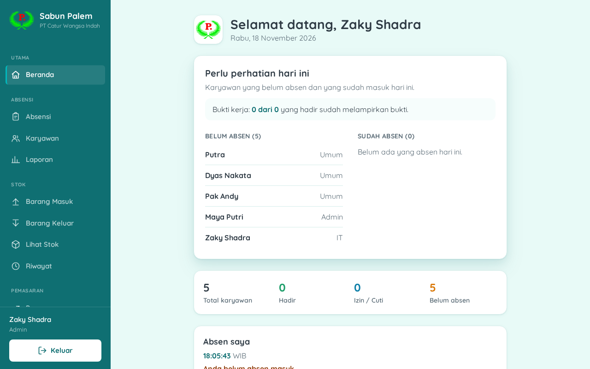
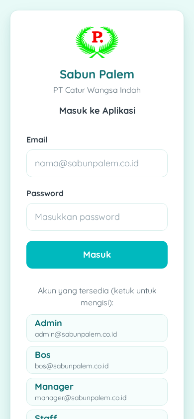
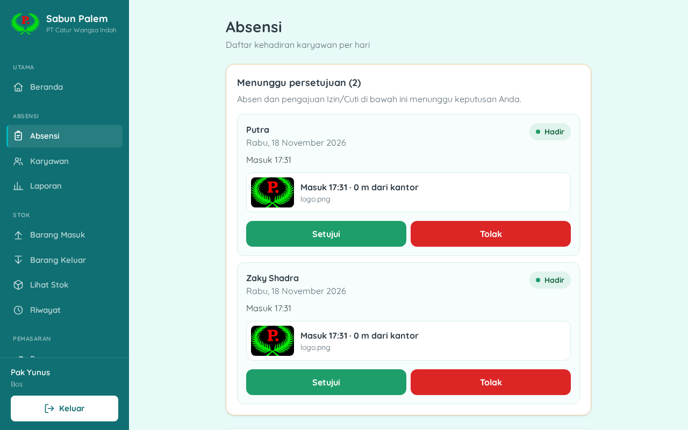
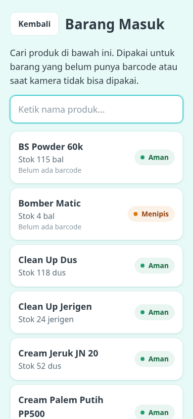

# Sabun Palem (Absensi + Stok)

Satu aplikasi untuk PT Catur Wangsa Indah (Sabun Palem): absensi
karyawan dan stok barang gudang, dalam satu tempat. Dibangun
untuk dipakai sehari-hari di HP, dengan tombol besar dan satu
layar satu tugas.

- **Absensi:** absen masuk/pulang dengan GPS + selfie, pengajuan
  Izin/Cuti, bukti kerja harian (foto/dokumen), daftar karyawan,
  laporan rekap. Setiap absen menunggu persetujuan Bos sebelum
  dihitung hadir.
- **Stok:** scan barcode barang masuk/keluar gudang, daftar stok
  per lokasi, riwayat transaksi, rekap per hari per gudang.
  Menggantikan kartu kertas "KARTU PERSEDIAAN BARANG" dan stock
  opname manual. Semua barang keluar lewat gudang, jadi satu scan
  di sini mencatat semua penjualan, online maupun offline.
- **Pemasaran:** ringkasan penjualan offline dari spreadsheet
  Analisis (total penjualan, kas masuk, grafik per bulan, 10
  produk terlaris). Hanya untuk manajemen dan karyawan yang diberi
  akses.



## Alamat live

| Layanan | Alamat |
| --- | --- |
| Aplikasi (utama) | https://caturwangsa.ices.my.id/ |
| Aplikasi (cadangan) | https://caturwangsa.pages.dev/ |
| Aplikasi (cadangan) | https://zakyshadra.github.io/stok-caturwangsa/ |
| Backend (Worker) | https://stok-sabun-palem.zakyshadra.workers.dev |

Aplikasi bisa dipasang sebagai PWA (ikon di layar HP, buka tanpa
browser). Status: **live**. Stok, absensi, karyawan, dan pemasaran
semuanya sudah tersambung ke backend.

## Akun

Login saat ini masih di sisi UI: ketuk salah satu akun di halaman
masuk, lalu ketuk Masuk. Auth asli (Cloudflare Access dengan
allowlist Gmail) masih menunggu persetujuan Pak Yunus, jadi untuk
sementara siapa pun yang membuka alamat aplikasi bisa masuk dengan
akun di bawah ini. Jangan anggap login ini sebagai pengaman.

| Email | Kata sandi | Role |
| --- | --- | --- |
| admin@sabunpalem.co.id | admin123 | Admin (Zaky Shadra) |
| bos@sabunpalem.co.id | bos123 | Bos (Pak Yunus) |
| manager@sabunpalem.co.id | manager123 | Manager (Ibu Abe) |
| staff@sabunpalem.co.id | staff123 | Staff (Putra) |

Login per karyawan (satu akun satu orang) ditunda sampai daftar
Gmail karyawan ada.



## Peran

Ada 4 peran. Staff adalah peran dasar, peran lain mewarisi
kemampuan Staff lalu ditambah haknya sendiri. Divisi (Produksi,
Admin, IT, Umum, dan lain-lain) BUKAN tingkat izin, hanya atribut
di data karyawan.

| Fitur | Admin (Zaky) | Bos (Pak Yunus) | Manager (Ibu Abe) | Staff |
| --- | --- | --- | --- | --- |
| Absen masuk/pulang + selfie | Ya (milik sendiri) | Tidak | Tidak | Ya (milik sendiri) |
| Ajukan Izin/Cuti | Ya (milik sendiri) | Tidak | Tidak | Ya (milik sendiri) |
| Setujui/Tolak absen + Izin/Cuti | Tidak | Ya (satu-satunya) | Tidak | Tidak |
| Lihat daftar hadir + selfie + bukti kerja | Semua | Semua | Semua | Milik sendiri |
| Tandai bukti kerja "sudah dicek" | Tidak | Tidak | Ya | Tidak |
| Kelola karyawan (tambah/ubah/hapus) | Ya (satu-satunya) | Lihat saja | Lihat saja | Tidak |
| Scan masuk/keluar + lihat stok/riwayat | Ya | Ya | Ya | Ya |
| Laporan + unduh CSV | Ya | Ya | Ya | Tidak |
| Pemasaran | Ya | Ya | Ya | Hanya kalau diberi capability `view-marketing` |

Catatan peran:

- **Tidak ada konsep Telat.** Jam kerja fleksibel, tidak ada jam
  mulai tetap. Jam masuk dan pulang tetap tercatat dan tampil, tapi
  tidak ada label telat di mana pun.
- **Bos satu-satunya approver.** Absen baru berstatus menunggu
  persetujuan; rekap hanya menghitung yang sudah disetujui. Kalau
  ditolak, karyawan harus absen ulang.
- **Manager dan Bos tidak absen.** Mereka kasta tertinggi di cabang
  ini, tidak ada yang memeriksa mereka. Ditambahkan hanya kalau
  mereka sendiri yang meminta.
- **Capability, bukan peran baru.** Data analyst (Dyas Nakata)
  adalah Staff yang diberi capability `view-marketing` lewat
  checkbox "Bisa lihat Pemasaran" di halaman Karyawan. Capability
  baru cukup tambah satu string + satu cek guard, tidak perlu
  peran baru.

## Halaman

| Rute | Isi | Role |
| --- | --- | --- |
| `/login` | Masuk dengan email + kata sandi | Semua |
| `/` | Beranda (lihat bawah) | Semua |
| `/absensi` | Absen masuk/pulang, bukti kerja, daftar hadir, ajukan Izin/Cuti | Semua |
| `/karyawan` | Daftar + tambah/ubah/hapus karyawan | Admin kelola, Bos/Manager lihat saja |
| `/laporan` | Rekap kehadiran per periode + unduh CSV | Admin, Bos, Manager |
| `/scan/masuk` | Scan barcode barang masuk | Semua |
| `/scan/keluar` | Scan barcode barang keluar | Semua |
| `/stok` | Daftar stok semua produk, ketuk untuk detail per lokasi | Semua |
| `/riwayat` | Log transaksi + rekap Per Hari per gudang | Semua |
| `/pemasaran` | Ringkasan penjualan offline + grafik | Manajemen + capability |
| `/akun` | Profil + tombol Keluar | Semua |

Beranda Staff: kartu "Absen saya hari ini" (jam live, tombol Absen
Masuk/Pulang), 3 tombol besar (Barang Masuk, Barang Keluar, Lihat
Stok), rekap saya bulan ini, ringkasan stok.

Beranda Admin/Bos/Manager: panel "Perlu perhatian hari ini" (yang
belum absen, absen yang menunggu persetujuan, bukti kerja yang
belum dilampirkan), statistik kehadiran, stok menipis.

## Alur absensi

1. Staff ketuk Absen Masuk di Beranda. Aplikasi cek lokasi GPS
   dulu: jarak ke kantor dihitung dengan rumus Haversine, radius
   yang diizinkan 200 meter. Di luar radius, absen ditolak ("Anda
   di luar area pabrik. Absen hanya bisa dilakukan di area
   pabrik."), tanpa jalan pintas. Koordinat kantor ada di
   `src/lib/attendance.ts` (`OFFICE_LOCATION`): Jl. Peta No. 71,
   Bandung (-6.93789, 107.59914). Angka itu dari geocoding dan
   bisa meleset dari pagar pabrik; kalau dipakai di lokasi lain
   (misal HQ Tasikmalaya), ubah angka di sana saja.
2. Setelah GPS lolos, staff foto selfie lewat kamera depan (ketuk
   "Ambil Foto Selfie"), dicek di preview, lalu ketuk "Ini Foto
   Saya". Selfie dikompres di HP (maksimal 640px, JPEG) lalu
   disimpan di database.
3. Status absen menjadi "Menunggu persetujuan" (badge kuning).
   Selama menunggu, absen belum dihitung Hadir di rekap, tapi juga
   bukan "Belum absen", dan tombol absen terkunci (dianggap sudah
   absen masuk).
4. Bos melihat antrean persetujuan di halaman Absensi (selfie +
   jam + jarak dari kantor), lalu ketuk Setujui atau Tolak.
5. Setelah absen masuk, staff melampirkan bukti kerja hari ini di
   halaman Absensi (foto atau dokumen, bisa lebih dari satu).
   Manager memeriksa bukti kerja lalu menekan "Tandai sudah
   dicek" (penanda saja, bukan persetujuan).
6. Staff ketuk Absen Pulang saat selesai kerja (verifikasi GPS +
   selfie yang sama berlaku untuk pulang).
7. Laporan: pilih rentang tanggal, lihat rekap per karyawan
   (Hadir/Izin/Cuti/Total), unduh CSV untuk Excel. Rekap hanya
   menghitung absen yang sudah disetujui.



## Alur scan

1. Buka Barang Masuk / Barang Keluar, kamera nyala otomatis.
2. Arahkan barcode ke dalam kotak. Bunyi beep = scan berhasil.
3. Kartu produk muncul: nama, stok saat ini per lokasi, status
   (Aman/Menipis/Habis).
4. Atur jumlah pakai tombol + dan - (tidak perlu mengetik).
5. Pilih lokasi (Gudang Klinik / Gudang Kantor / Kantor).
6. Pilih keterangan (Jualan Magang, Konsinyasi, Stok Gudang, dan
   lain-lain, dari kartu kertas asli).
7. Ketuk Simpan. Layar sukses menampilkan stok baru.
8. Kalau salah input, ketuk "Batalkan, saya salah input" di layar
   sukses.

Tidak ada barcode? Ketuk "Cari Manual", cari nama produk, lanjut
sama seperti habis scan. 4 produk belum punya barcode: BS Powder
60k, Bomber Matic, Jelly Cream 140gr, Jelly Pink Toples.



## Data

- **Produk:** 24 produk, 20 sudah punya barcode EAN-13. Daftar
  produk dan barcode dari tab info_produk sheet perusahaan.
- **Stok:** Worker hanya menambah baris ke tab Log Transaksi
  (append-only, tidak pernah menimpa). Stok terkini dihitung rumus
  SUMIFS dari Log di tab Stok Terkini. Alasannya: dua orang yang
  scan bersamaan tidak akan saling menimpa, dan semua perubahan
  punya jejak audit lengkap (siapa, kapan, berapa).
- **Sheet:** aplikasi menulis ke salinan dev "SO Detail - COPY DEV
  (Stok Sabun Palem)". Sheet asli perusahaan TIDAK PERNAH diubah.
  Tab bulanan (misal "November 2026") dibuat otomatis tiap tanggal
  1 jam 00:00 WIB sebagai skeleton, mengikuti persis format tab
  opname asli perusahaan (grup tanggal dengan Gudang Klinik,
  Gudang Kantor, Kantor, Total Barang; 36 baris produk). Grup
  tanggal baru ditambahkan otomatis saat ada pergerakan di
  tanggal itu.
- **Absensi + karyawan:** tinggal di database D1
  (sabun-palem-absen), 6 tabel: attendance, photos, verification,
  evidence, evidence_reviews, employees. Foto selfie disimpan
  sebagai base64 di D1 (R2 butuh detail billing, jadi tidak
  dipakai).
- **Pemasaran:** dibaca live dari sheet "Analisis Penjualan
  Offline 2026" setiap request (cache maksimal 60 detik). Sheet
  itu tidak punya kolom pengeluaran, jadi grafiknya adalah
  Penjualan vs Kas Masuk, bukan Pemasukan vs Pengeluaran.

Detail lengkap ada di [docs/arsitektur.md](docs/arsitektur.md).

## Cara jalanin

```bash
npm install
npm run dev
```

Buka http://localhost:5173. Untuk scan barcode, buka lewat HP
(kamera HP jauh lebih bagus dari webcam laptop) atau izinkan kamera
di laptop.

Build produksi:

```bash
npm run build
npm run preview
```

Tanpa `VITE_API_URL`, aplikasi memakai data lokal (stok dari daftar
statis, absensi dan karyawan di memori sesi). Dengan
`VITE_API_URL=https://stok-sabun-palem.zakyshadra.workers.dev`,
aplikasi tersambung ke backend live.

Deploy ke Cloudflare Pages (manual, tidak ada integrasi Git):

```bash
VITE_API_URL=https://stok-sabun-palem.zakyshadra.workers.dev npm run build:pages
npx wrangler pages deploy dist --project-name caturwangsa
```

GitHub Pages deploy otomatis setiap push ke main (workflow
`.github/workflows/deploy-pages.yml`). Deploy Worker dan skema D1
ada di [docs/panduan-developer.md](docs/panduan-developer.md).

## Struktur kode

```
src/
  lib/
    types.ts          Tipe data stok (Product, Transaction, LocationId)
    products.ts       Daftar 24 produk + riwayat awal (cadangan lokal)
    api.ts            Lapisan data stok (fetch ke Worker, cadangan lokal)
    store.tsx         State global stok (React Context)
    beep.ts           Bunyi beep + getar saat scan berhasil
    attendance.ts     Tipe + data absensi (Role, User, Employee,
                      AttendanceRecord, EvidenceFile, CheckVerification),
                      lokasi kantor + radius geofence 200 m, rumus jarak
                      Haversine, helper tanggal/waktu WIB, guard
                      canViewMarketing
    auth.tsx          Auth (React Context), login/logout,
                      tersimpan di localStorage
    attendance-state.tsx  State absensi (React Context): catatan absen
                      dipakai bersama Beranda/Absensi/Laporan
    attendance-api.ts Lapisan data absensi (fetch ke Worker, cadangan lokal)
    employees.tsx     State karyawan (React Context): daftar dari API
                      D1, tambah/ubah/hapus tersimpan permanen
    employees-api.ts  Lapisan data karyawan (fetch ke Worker, cadangan lokal)
  components/
    ui.tsx            Tombol besar, badge status, stepper, pilih lokasi
    CheckInFlow.tsx   Flow absen: langkah 1 cek lokasi GPS, langkah 2
                      foto selfie (kamera depan lewat input capture).
                      Overlay layar penuh via Portal.
    Layout.tsx        Sidebar desktop (grup UTAMA/ABSENSI/STOK,
                      pill berjalan) + wrapper konten
    BottomNav.tsx     Navigasi bawah HP, 5-6 item, pill berjalan
                      mengikuti lebar teks label
    BarcodeScanner.tsx Kamera + BarcodeDetector (native) / ZXing (fallback)
    charts/           Grafik Bklit (89 file, vendored)
  pages/
    Login.tsx      Masuk
    Home.tsx       Beranda gabungan (Staff / Admin-Bos-Manager)
    Attendance.tsx Absensi + bukti kerja + ajukan Izin/Cuti
    Employees.tsx  Daftar + kelola karyawan
    Reports.tsx    Rekap kehadiran + unduh CSV
    Scan.tsx       Scan masuk/keluar + cari manual + sukses
    Stock.tsx      Daftar stok + detail per lokasi
    History.tsx    Riwayat transaksi + rekap Per Hari
    Marketing.tsx  Ringkasan penjualan offline + grafik
    Account.tsx    Profil + keluar
worker/
  src/
    index.ts       Router Hono: endpoint stok + log + bulanan +
                   pemasaran, CORS, cron tab bulanan
    sheets.ts      Baca/tulis Google Sheets via service account
    attendance.ts  Endpoint absensi (D1)
    employees.ts   Endpoint karyawan (D1)
  schema.sql       Skema D1 (6 tabel)
  wrangler.toml    Konfigurasi Worker + binding D1 + cron
```

## Desain

Token warna, tipografi, dan perilaku ada di `DESIGN.md`.
Ringkasan:

- Warna dari situs resmi perusahaan: cyan #00B9BE, teal gelap
  #0F6F72, latar mint #E8FAF7, font Quicksand.
- Baby-boomer friendly: tombol utama minimal 56px, teks minimal
  14px, semua tombol ada label teksnya, satu layar satu tugas.
- Hijau = Barang Masuk dan Hadir, oranye = Barang Keluar, biru =
  Lihat Stok dan Izin/Cuti. Merah hanya untuk Habis dan error.
- Animasi: pill nav berjalan 0.45s, kartu masuk stagger 50ms,
  semua di bawah 300ms, transform + opacity saja.
- Komentar kode dalam Bahasa Indonesia, menjelaskan ALASAN
  (arsitektur, jebakan, keputusan), bukan mengulang isi kode.
  Identifier kode dan pesan commit dalam Bahasa Inggris.
- Catatan teknis: overlay fullscreen (misal lightbox foto bukti
  kerja) harus dirender lewat React Portal ke document.body,
  karena wrapper halaman punya animasi transform yang membuat
  position:fixed di dalamnya relatif ke halaman, bukan ke layar.

## Dokumentasi lain

- [docs/panduan-pengguna.md](docs/panduan-pengguna.md): cara pakai
  aplikasi untuk Staff, Admin, Bos, dan Manager.
- [docs/panduan-developer.md](docs/panduan-developer.md): setup,
  deploy, konvensi, dan cara uji.
- [docs/arsitektur.md](docs/arsitektur.md): arsitektur backend,
  skema Sheet dan D1, endpoint API.
- [docs/migrasi-akun.md](docs/migrasi-akun.md): cara memindahkan
  backend ke akun perusahaan.

## Yang belum ada (nanti)

- Auth asli: Cloudflare Access dengan allowlist Gmail (tanpa PIN).
  Menunggu persetujuan Pak Yunus.
- Login per karyawan (satu akun satu orang). Menunggu daftar Gmail
  karyawan.
- Print barcode internal untuk 4 produk yang belum punya barcode.
- Stock opname mode scan massal (scan semua barang, bandingkan
  dengan stok sistem).
- Auto-reply chat (WhatsApp/Shopee/Tokopedia/Instagram). Ditunda,
  menunggu keputusan soal biaya.
