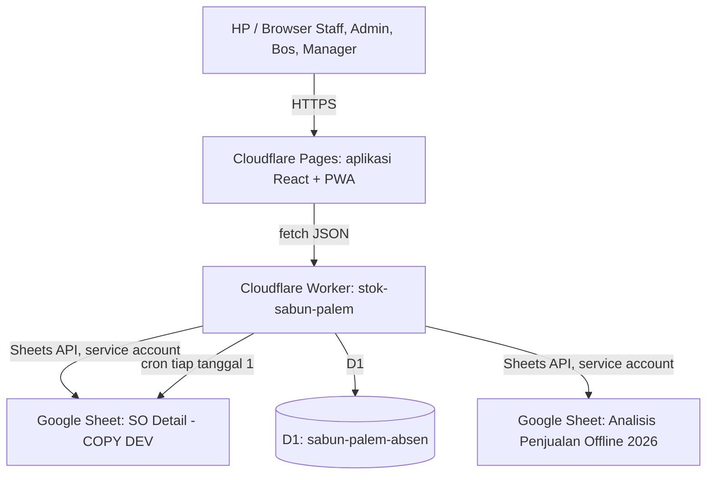
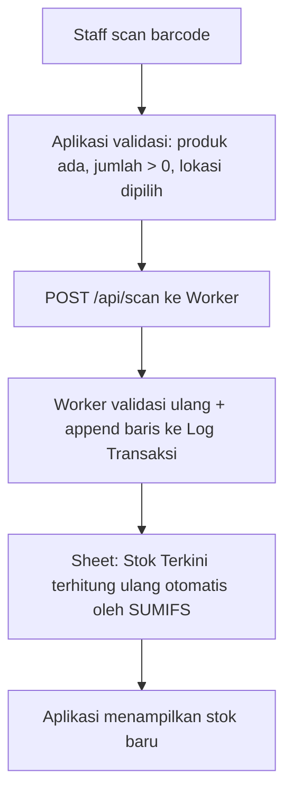
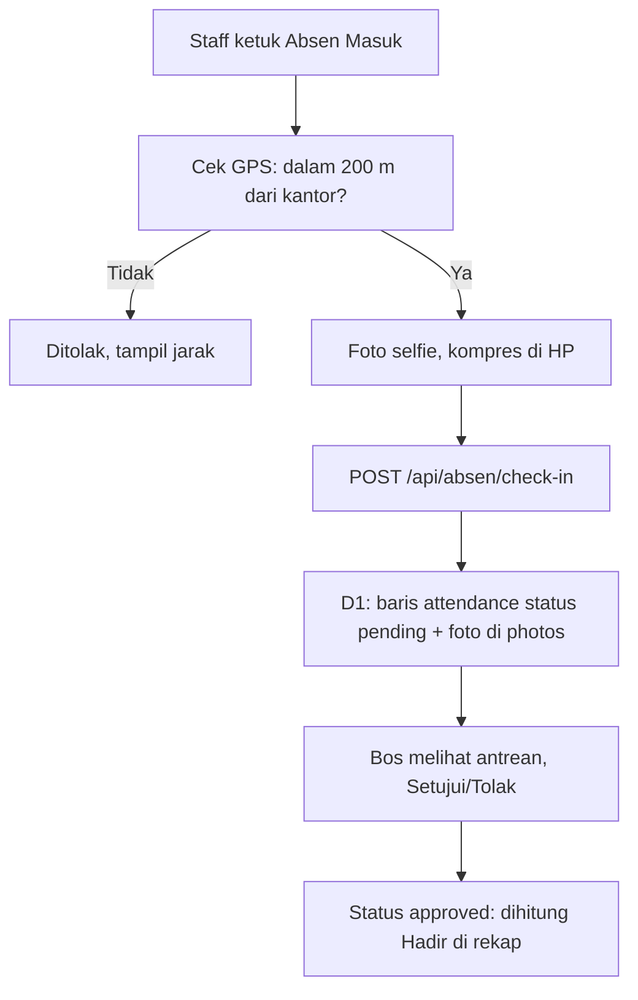

# Arsitektur: Aplikasi Sabun Palem

Dokumen ini menjelaskan bagaimana sistem bekerja di balik layar:
komponen apa saja yang ada, data mengalir ke mana, dan kenapa
diputuskan begitu. Untuk cara pakai, lihat
[panduan-pengguna.md](panduan-pengguna.md); untuk cara develop dan
deploy, lihat [panduan-developer.md](panduan-developer.md).

## 1. Gambaran sistem

Semua komponen memakai free tier (Cloudflare + Google), tanpa
server sendiri.

| Komponen | Teknologi | Keterangan |
| --- | --- | --- |
| Aplikasi web | Vite + React 19 + TypeScript + Tailwind 3 | PWA (manifest + service worker). Hosting Cloudflare Pages + GitHub Pages. |
| Backend | Cloudflare Workers (Hono) | Satu Worker untuk stok, absensi, karyawan, pemasaran. |
| Stok | Google Sheets | Tab Log Transaksi (append-only) + Stok Terkini (SUMIFS) + tab bulanan. |
| Absensi + karyawan | Cloudflare D1 (SQLite) | 6 tabel, lihat bagian 4. |
| Pemasaran | Google Sheets | Dibaca live dari sheet Analisis. |

URL live: aplikasi https://caturwangsa.ices.my.id/ (utama),
https://caturwangsa.pages.dev/, https://zakyshadra.github.io/stok-caturwangsa/;
Worker https://stok-sabun-palem.zakyshadra.workers.dev.

## 2. Kenapa stok di Spreadsheet, absensi di D1

Keputusan ini disengaja, bukan kebetulan:

- **Stok di Sheet** karena perusahaan sudah bekerja dengan Sheet
  (SO Detail adalah dokumen mereka). Staf gudang dan manager bisa
  membuka Sheet langsung dan melihat angka yang sama dengan
  aplikasi. Rumus SUMIFS di Sheet juga berarti stok bisa dihitung
  ulang tanpa aplikasi.
- **Absensi di D1** karena data absensi butuh relasi dan query
  yang tidak enak di Sheet (persetujuan, selfie per karyawan per
  hari, bukti kerja, review Manager). D1 adalah SQLite sungguhan
  dengan query SQL, dan tetap gratis.

Aturan pemisahnya: kalau datanya perlu dilihat/diubah langsung
oleh orang perusahaan di Sheet, taruh di Sheet. Kalau datanya
hanya dipakai aplikasi dan butuh relasi, taruh di D1.

## 3. Google Sheets

### 3.1 Sheet stok (yang ditulis aplikasi)

**"SO Detail - COPY DEV (Stok Sabun Palem)"**, ID
`1SRXE0Ma1VXO_W1DJJ1GISM0Tmcnbr9w8eGyBrQj2IhA`. Ini SALINAN dev
dari sheet perusahaan. **Sheet asli perusahaan ("SO Detail", ID
`1W_yuCHb1UwhKoo2da90vB9e06FS00G15YlqypuooGfE`) tidak pernah
diubah oleh aplikasi.** Locale sheet id_ID (rumus memakai
pemisah `;`), zona waktu Asia/Jakarta.

| Tab | Isi |
| --- | --- |
| Log Transaksi | Semua transaksi stok. Kolom: Timestamp, Barcode, Produk, Lokasi, Jenis (Masuk/Keluar), Jumlah, Keterangan, Petugas, Tanggal. Baris baru disisipkan di baris 2 (terbaru di atas). Append-only: Worker tidak pernah mengubah atau menghapus baris lama. |
| Stok Terkini | Stok per produk per lokasi, dihitung rumus SUMIFS dari Log Transaksi. |
| info_produk | Daftar produk: Nama item, Kode barcode item, Satuan ukuran. 24 produk, 20 punya barcode EAN-13. |
| pricelist terbaru | Harga jual per produk + kolom Kuantitas live (VLOOKUP ke Stok Terkini). Harga mengikuti sheet apa adanya. |
| November 2026, Desember 2026, ... | Tab bulanan, dibuat otomatis tiap tanggal 1 (lihat 3.2). Tab Feb-Sep 2026 adalah tab asli perusahaan, jangan diubah. |

### 3.2 Tab bulanan

Satu tab per bulan, mengikuti persis format tab opname asli
perusahaan (misal "Juli 2026"): baris 1 header tanggal per grup
("09 Juli 2026"), baris 2 kosong, baris 3 header lokasi (Gudang
Klinik, Gudang Kantor, Kantor, Total Barang), baris 4 sub-header
(No, Nama Item, lalu per grup: Unit, Satuan, Unit, Satuan, Unit,
Satuan, Jml, Unit, Keterangan), baris 5-40 berisi 36 produk
dengan nama persis tab September 2026. Nilai tiap grup adalah
snapshot stok akhir hari itu per lokasi (SUMIFS kumulatif dari
Log Transaksi); Total Barang = jumlah ketiga lokasi. Kolom
Satuan memakai singkatan perusahaan (Jrg, Ball, Dus, Pcs,
Toples) dan "-" kalau stoknya 0.

Satu-satunya perbedaan dari format asli: grup tanggal tidak
dicetak semua di awal. Tab baru dibuat sebagai skeleton (tanpa
grup tanggal); grup ditambahkan otomatis saat ada pergerakan
(scan) di tanggal itu. Nama produk di tab berbeda dari nama di
Log (misal tab "Palem Dwl Jerigen" = Log "DWL Palem Jerigen"),
pemetaannya ada di MONTHLY_ROWS (worker/src/monthly.ts). 19
produk terpetakan; 3 ambigu (Bs powder 1kg, Bs Powder Karung,
Jelly Toples) dan 14 tanpa data di Log dibiarkan kosong; 3
produk Log (Bomber Matic, Clean Up Dus, FK110) tidak punya
baris di tab bulanan.

Batas yang perlu diketahui: tab bulanan menampilkan snapshot
stok per tanggal, tidak bisa memisahkan Masuk vs Keluar
(transaksi masuk dan keluar di hari yang sama saling
meniadakan). Detailnya ada di Log Transaksi.

Tab bulan baru dibuat otomatis oleh cron Worker (`0 17 1 * *`,
artinya jam 00:00 WIB tanggal 1). Kalau tab bulan itu sudah ada,
cron melewatinya. Tab lama bisa dibangun ulang ke format baru
dengan `POST /api/monthly/rebuild`.

### 3.3 Sheet pemasaran (hanya dibaca)

**"Analisis Penjualan Offline 2026"**, ID
`1dj-_r50KK4aZOCwKcj1qnq_zR8Md4zfuRiZxzTgtIfc`. Worker membaca
sheet ini live setiap request (cache maksimal 60 detik) dan
menghitung agregat bulanan + 10 produk terlaris. Sheet ini hanya
melacak penjualan dan pemasukan, bukan stok, dan tidak punya kolom
pengeluaran. Karena itu grafik Pemasaran adalah Penjualan vs Kas
Masuk, bukan Pemasukan vs Pengeluaran.

### 3.4 Akses Sheets

Worker memakai service account Google Cloud (project
`sabun-palem-stok`, service account
`stok-sabun-palem@pacific-nuance-515100-u5.iam.gserviceaccount.com`)
dengan Sheets API. Email + private key disimpan sebagai Worker
secrets (`SHEETS_CLIENT_EMAIL`, `SHEETS_PRIVATE_KEY`), tidak
pernah masuk repo. Service account diberi akses Editor di kedua
sheet di atas.

## 4. Database D1 (sabun-palem-absen)

Database ID `06dd5164-3722-47df-875f-807394e42aed`. Skema lengkap
di `worker/schema.sql`. 6 tabel:

| Tabel | Isi |
| --- | --- |
| attendance | Satu baris per karyawan per hari: jam masuk/pulang, status (Hadir/Izin/Cuti), status persetujuan (pending/approved/rejected). |
| photos | Foto selfie (base64 JPEG hasil kompres) + metadata (karyawan, tanggal, masuk/pulang). |
| verification | Hasil verifikasi tiap absen: jarak GPS, waktu, kunci foto selfie. |
| evidence | Bukti kerja yang diunggah staff (file base64 + nama + tipe). |
| evidence_reviews | Penanda "sudah dicek" Manager: satu baris per karyawan per hari (kunci utama gabungan employee_id + date). |
| employees | Daftar karyawan: id, name, division, position, phone, active, capabilities (teks JSON, array string). |

Catatan desain:

- **Tidak ada foreign key** dari attendance/evidence ke
  employees. `employee_id` hanya INTEGER biasa. Akibatnya,
  menghapus karyawan tidak menghapus catatan absennya (namanya
  tampil sebagai "-" di rekap lama). Ini disengaja: riwayat
  kehadiran tidak boleh hilang karena karyawannya keluar.
- **Foto sebagai base64 di D1**, bukan R2. R2 butuh detail
  billing di akun Cloudflare, jadi tidak dipakai. Foto dikompres
  di sisi klien (maksimal 640px, JPEG 0.82, sekitar 30-100 KB
  per foto). Untuk 7 karyawan, kapasitas D1 cukup bertahun-tahun.
  Bentuk API tidak berubah kalau suatu saat pindah ke R2.
- **Seed employees.** Saat tabel employees kosong (pertama kali),
  GET /api/karyawan mengisinya dari 5 karyawan awal: Putra (1),
  Dyas Nakata (2, capability `view-marketing`), Pak Andy (3),
  Maya Putri (4, dummy placeholder untuk 4 karyawati yang namanya
  belum diketahui), Zaky Shadra (5, Admin). Daftar statis
  `EMPLOYEES` di aplikasi dipakai sebagai cadangan kalau API
  tidak bisa dihubungi.

## 5. Endpoint API Worker

Base URL: https://stok-sabun-palem.zakyshadra.workers.dev

| Endpoint | Deskripsi |
| --- | --- |
| GET / | Health check |
| GET /api/stock | Stok terkini (dari Sheet) |
| GET /api/log | Log transaksi (dari Sheet) |
| POST /api/scan | Catat transaksi masuk/keluar (append ke Log) |
| POST /api/scan/undo | Batalkan transaksi terakhir |
| GET /api/monthly?month=YYYY-MM | Rekap per hari per lokasi (dari Log) |
| POST /api/monthly/create | Buat tab bulanan baru |
| POST /api/monthly/rebuild | Bangun ulang tab bulanan dari Log (migrasi format) |
| POST /api/monthly/ensure | Tambah grup satu tanggal ke tab bulanan |
| GET /api/marketing | Agregat penjualan offline (dari sheet Analisis) |
| GET /api/absen?month=YYYY-MM | Daftar absen + review (dari D1) |
| POST /api/absen/check-in | Absen masuk (GPS + selfie) |
| POST /api/absen/check-out | Absen pulang (GPS + selfie) |
| POST /api/absen/approve | Setujui/Tolak absen (Bos) |
| POST /api/absen/leave | Ajukan Izin/Cuti |
| POST /api/absen/evidence | Unggah bukti kerja |
| POST /api/absen/evidence-review | Tandai bukti kerja sudah dicek (Manager) |
| GET /api/absen/foto/:key | Ambil foto selfie |
| GET /api/karyawan | Daftar karyawan (seed kalau kosong) |
| POST /api/karyawan | Tambah karyawan |
| PUT /api/karyawan/:id | Ubah karyawan |
| DELETE /api/karyawan/:id | Hapus karyawan |

Semua body POST/PUT divalidasi di Worker (tipe, panjang, nilai);
request yang tidak benar ditolak 400, id yang tidak ada 404,
gagal baca/tulis database atau Sheet 502. Timestamp transaksi
diambil dari jam server Worker, bukan dari HP (jam HP bisa salah).

CORS: hanya origin yang diizinkan di `worker/wrangler.toml`
(`ALLOWED_ORIGINS`): zakyshadra.github.io, caturwangsa.ices.my.id,
caturwangsa.pages.dev, dan localhost:5173.

## 6. Model peran dan capability

- **Peran adalah tingkat izin.** Ada 4: Admin, Bos, Manager,
  Staff. Staff adalah peran dasar; peran lain mewarisi kemampuan
  Staff lalu ditambah haknya. Matriks lengkap ada di README.
- **Divisi adalah atribut.** Satu string di record karyawan
  (Produksi, Admin, IT, Umum, dan lain-lain). Divisi tidak
  mengubah izin apa pun. Kalau suatu saat ada aturan khusus
  divisi, cukup satu if-check, bukan struktur peran baru.
- **Capability adalah tambahan per orang.** Array string di record
  karyawan (`capabilities`). Saat ini hanya ada satu:
  `view-marketing` (boleh melihat menu Pemasaran, dipakai Dyas
  Nakata, data analyst). Admin mengubahnya lewat checkbox di
  halaman Karyawan. Capability baru cukup tambah satu string +
  satu guard check, tidak perlu peran baru dan tidak perlu
  migrasi database.

Guard di aplikasi: `canViewMarketing` di `src/lib/attendance.ts`,
rute `RequireManagement` dan `RequireMarketing` di `src/App.tsx`,
dan navigasi di `src/components/Layout.tsx` +
`src/components/BottomNav.tsx`.

**Batasan keamanan saat ini:** enforcement peran masih UI-only.
Worker belum memeriksa siapa yang memanggil endpoint-nya, jadi
siapa pun yang tahu URL Worker bisa membaca log dan menulis scan
palsu. Perbaikannya adalah Cloudflare Access (allowlist Gmail),
yang masih menunggu persetujuan Pak Yunus. Sampai saat itu, URL
Worker jangan disebarluaskan, dan login di aplikasi jangan dianggap
sebagai pengaman.

## 7. PWA dan caching

Aplikasi adalah PWA sungguhan: `manifest.webmanifest` (nama Sabun
Palem, mode standalone, ikon dari logo resmi) + service worker
(`public/sw.js`).

- Shell aplikasi (HTML/CSS/JS) memakai strategi cache-first:
  dibuka sekali, setelah itu bisa dibuka tanpa internet
  (tampilannya saja, datanya tetap butuh internet).
- Request API memakai strategi network-first: selalu coba internet
  dulu, cadangan cache hanya kalau offline.

## 8. Alur data utama

**Scan barang keluar:**

**Absen masuk:**

Prinsip yang dipegang di semua alur: **validasi di dua tempat**
(aplikasi dan Worker), **tulis sekali di satu tempat** (Log untuk
stok, D1 untuk absensi), **tidak pernah menimpa data lama**
(append-only untuk Log; status berubah, baris tidak dihapus).
