# Panduan Pengguna: Aplikasi Sabun Palem

Panduan ini untuk semua yang memakai aplikasi: Staff, Admin, Bos,
dan Manager. Bahasa dibuat sesederhana mungkin; istilah teknis
dijelaskan saat pertama kali muncul.

Aplikasi ini menggabungkan dua pekerjaan: **absensi** (siapa masuk,
jam berapa, bukti kerjanya apa) dan **stok gudang** (barang apa
yang masuk/keluar, sisa berapa). Satu aplikasi, satu login.

## 1. Membuka aplikasi

Alamat utama: **https://caturwangsa.ices.my.id/**

Buka alamat itu di browser HP (Chrome di Android, Safari di
iPhone). Aplikasi bisa dipasang supaya muncul sebagai ikon di layar
HP, seperti aplikasi biasa:

- **Android (Chrome):** ketuk menu titik tiga, pilih "Tambahkan ke
  Layar Utama" atau "Install aplikasi".
- **iPhone (Safari):** ketuk tombol Bagikan, pilih "Tambah ke Layar
  Utama".

Setelah dipasang, ketuk ikonnya untuk membuka, tidak perlu ketik
alamat lagi.

## 2. Masuk (login)

Di halaman masuk, ketuk salah satu akun yang tersedia, lalu ketuk
tombol **Masuk**. Email dan kata sandi terisi otomatis.

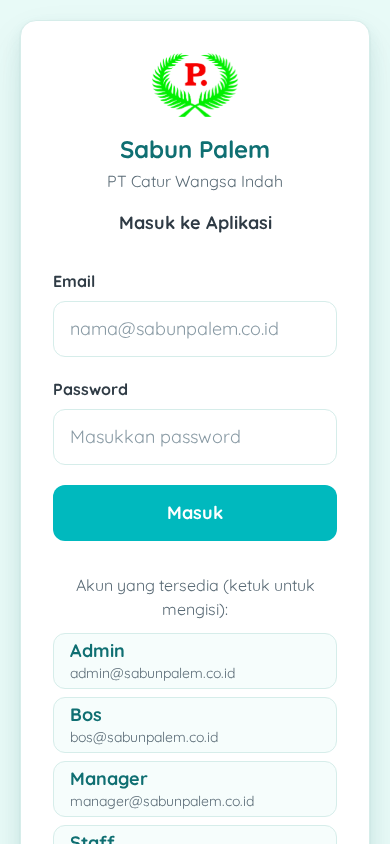

| Akun | Untuk siapa |
| --- | --- |
| Admin | Zaky (IT/magang) |
| Bos | Pak Yunus |
| Manager | Ibu Abe |
| Staff | Karyawan (saat ini Putra) |

Catatan: untuk sementara akun masih akun bersama per peran. Login
satu akun satu karyawan akan dibuat setelah daftar Gmail karyawan
ada. Kalau sudah selesai memakai aplikasi di HP bersama, keluar
lewat menu **Akun**, tombol **Keluar**.

## 3. Beranda

Setelah masuk, yang pertama tampil adalah Beranda. Isinya
berbeda-beda menurut peran.

**Beranda Staff** berisi kartu "Absen saya hari ini" (tombol Absen
Masuk/Pulang), tiga tombol besar (Barang Masuk, Barang Keluar,
Lihat Stok), rekap absensi bulan ini, dan ringkasan stok.

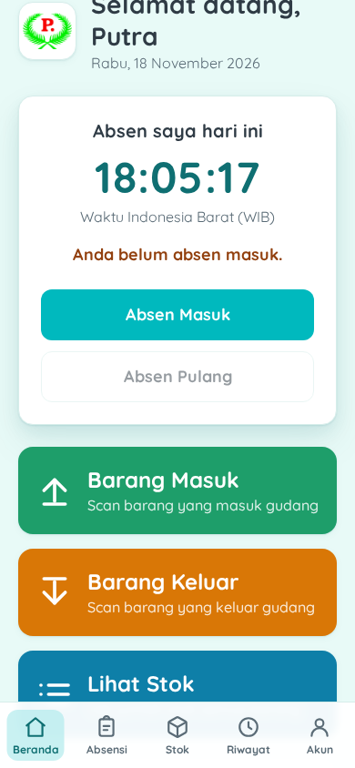

**Beranda Bos/Manager/Admin** berisi panel "Perlu perhatian hari
ini" (siapa yang belum absen, absen apa yang menunggu persetujuan,
bukti kerja apa yang belum dilampirkan), statistik kehadiran, dan
stok yang menipis.

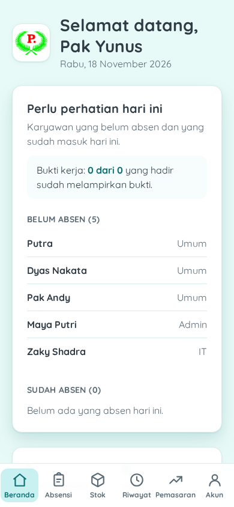

Navigasi di bawah layar HP: Beranda, Absensi, Stok, Riwayat,
Pemasaran (hanya peran tertentu, lihat bagian 8), Akun.

## 4. Absensi (Staff dan Admin)

### 4.1 Absen masuk

1. Di Beranda, ketuk **Absen Masuk**.
2. Aplikasi mengecek lokasi HP dulu. Absen hanya bisa dilakukan
   dalam radius 200 meter dari pabrik (Jl. Peta No. 71, Bandung).
   Kalau di luar radius, muncul pesan penolakan beserta jaraknya.
   Tidak ada cara lain untuk absen dari luar area.
3. Setelah lokasi lolos, foto selfie lewat kamera depan. Ketuk
   **Ambil Foto Selfie**, periksa hasilnya, lalu ketuk **Ini Foto
   Saya**.
4. Selesai. Status absen menjadi **Menunggu persetujuan** (badge
   kuning). Absen belum dihitung Hadir sampai Bos menyetujuinya,
   tapi tombol absen sudah terkunci karena dianggap sudah absen.

Jam kerja di sini fleksibel: **tidak ada konsep telat**. Tidak ada
jam mulai tetap dan tidak ada label telat. Jam masuk tetap
tercatat dan bisa dilihat Bos/Manager.

### 4.2 Absen pulang

Ketuk **Absen Pulang** di Beranda saat selesai kerja. Langkahnya
sama: cek lokasi, lalu selfie.

### 4.3 Kalau absen ditolak Bos

Status berubah menjadi **Ditolak**, disertai pesan untuk absen
ulang. Absen lagi seperti biasa.

### 4.4 Bukti kerja

Setelah absen masuk, lampirkan bukti kerja hari ini di halaman
**Absensi**: foto atau dokumen hasil kerja (bisa lebih dari satu).
Bos dan Manager bisa melihatnya. Manager akan menandainya setelah
diperiksa (lihat bagian 6).

### 4.5 Izin / Cuti

Di halaman **Absensi**, isi form "Ajukan Izin / Cuti": pilih
tanggal, pilih Izin atau Cuti, ketuk **Kirim Pengajuan**.
Pengajuan menunggu persetujuan Bos; sebelum disetujui, statusnya
tampil sebagai Izin atau Cuti (menunggu).

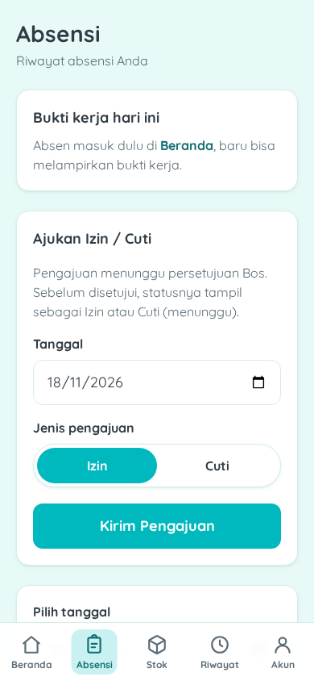

## 5. Persetujuan absen (Bos)

Bos adalah satu-satunya yang menyetujui atau menolak absen dan
pengajuan Izin/Cuti.

1. Buka halaman **Absensi**. Bagian "Menunggu persetujuan"
   menampilkan semua absen dan pengajuan yang belum diputuskan.
2. Tiap kartu menampilkan nama, tanggal, jam masuk, selfie
   beserta jaraknya dari kantor. Ketuk foto untuk memperbesar.
3. Ketuk **Setujui** atau **Tolak**.

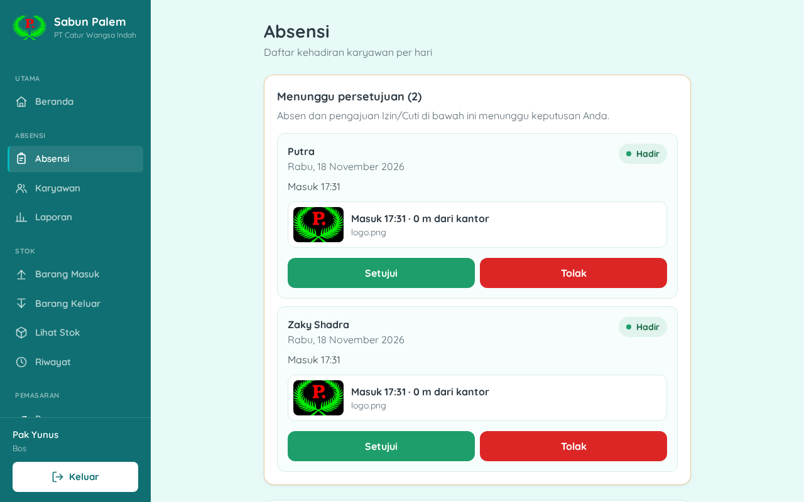

Rekap kehadiran hanya menghitung absen yang sudah disetujui. Absen
yang masih menunggu tidak dihitung, tapi juga tidak dihitung
sebagai tidak hadir.

Bos tidak absen sendiri, dan tidak mengelola daftar karyawan. Bos
bisa melihat daftar karyawan (lihat saja) di halaman **Karyawan**.

## 6. Memeriksa bukti kerja (Manager)

Manager memeriksa laporan tiap karyawan dan bukti kerja mereka:

1. Buka halaman **Absensi**, pilih tanggal.
2. Lihat kartu tiap karyawan: jam masuk/pulang, selfie, dan bukti
   kerja yang dilampirkan.
3. Setelah memeriksa bukti kerja seseorang, ketuk **Tandai sudah
   dicek**. Tanda ini tersimpan dan terlihat oleh Bos juga. Ini
   hanya penanda "sudah diperiksa", bukan persetujuan absen
   (persetujuan tetap wewenang Bos).

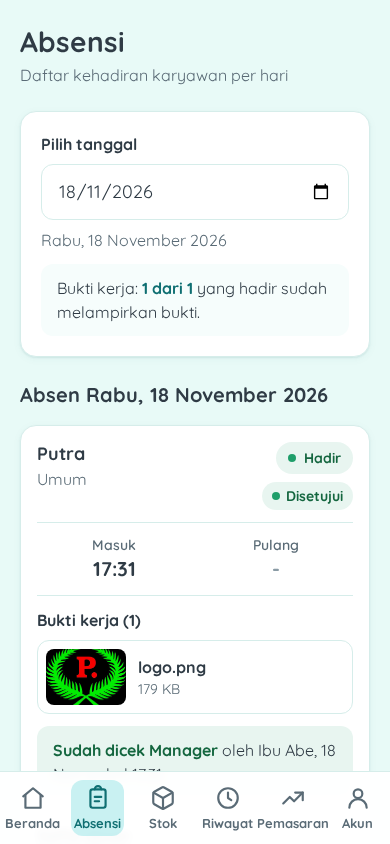

Manager juga bisa melihat laporan rekap di halaman **Laporan** dan
daftar karyawan (lihat saja) di halaman **Karyawan**. Manager tidak
absen sendiri, tidak mengajukan Izin/Cuti, dan tidak mengelola
daftar karyawan.

## 7. Mengelola karyawan (Admin)

Hanya Admin yang menambah, mengubah, dan menghapus karyawan, di
halaman **Karyawan**.

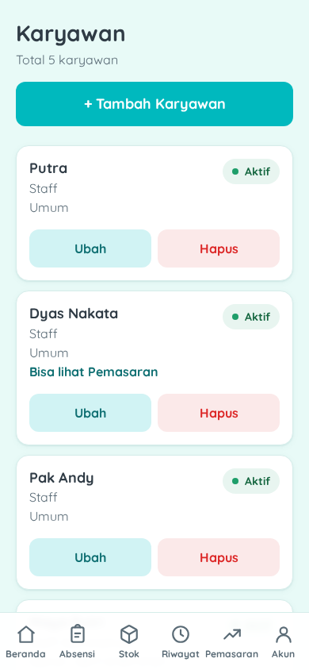

- **Tambah:** ketuk **+ Tambah Karyawan**, isi nama (wajib),
  divisi, jabatan, dan nomor HP, lalu Simpan.
- **Ubah:** ketuk **Ubah** di kartu karyawan, ubah isinya, Simpan.
- **Hapus:** ketuk **Hapus**, konfirmasi. Catatan absen karyawan
  yang dihapus tidak ikut hilang dari rekap lama, tapi namanya
  tampil sebagai "-" di sana. Jadi hapus hanya kalau memang sudah
  tidak bekerja di sini.
- **Akses Pemasaran:** centang **"Bisa lihat Pemasaran"** pada
  karyawan yang boleh melihat menu Pemasaran (saat ini Dyas
  Nakata, data analyst). Perubahan tersimpan permanen dan langsung
  berlaku di semua HP.

Perubahan karyawan tersimpan di server: tidak hilang saat aplikasi
ditutup, dan terlihat di HP lain.

## 8. Stok: scan barang masuk dan keluar

### 8.1 Scan dengan kamera

1. Di Beranda, ketuk **Barang Masuk** atau **Barang Keluar**.
   Kamera menyala otomatis.
2. Arahkan barcode produk ke dalam kotak. Bunyi beep berarti scan
   berhasil.
3. Kartu produk muncul: nama, stok saat ini per lokasi, status
   (Aman/Menipis/Habis).
4. Atur jumlah dengan tombol **+** dan **-** (tidak perlu mengetik
   angka).
5. Pilih lokasi: Gudang Klinik, Gudang Kantor, atau Kantor.
6. Pilih keterangan: Jualan Magang, Jualan Offline, Konsinyasi,
   Sample, Stok Gudang, dan lain-lain.
7. Ketuk **Simpan**. Layar sukses menampilkan stok baru produk itu.

### 8.2 Salah input?

Di layar sukses, ketuk **"Batalkan, saya salah input"**. Transaksi
dibatalkan dan stok kembali seperti semula.

### 8.3 Produk tanpa barcode

Empat produk belum punya barcode: BS Powder 60k, Bomber Matic,
Jelly Cream 140gr, Jelly Pink Toples. Untuk produk-produk ini (atau
kalau kamera tidak bisa dipakai), ketuk **Cari Manual**, ketik nama
produk, pilih dari daftar, lalu lanjut seperti habis scan.

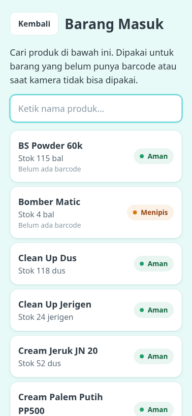

### 8.4 Melihat stok dan riwayat

- **Stok:** daftar semua produk beserta sisa dan statusnya. Ketuk
  produk untuk melihat stok per lokasi.
- **Riwayat:** semua transaksi masuk/keluar (tanggal, keterangan,
  jumlah, petugas). Tampilan "Per Hari" menampilkan stok akhir
  tiap hari, dengan filter per gudang (Semua, Klinik, Gdg Kantor,
  Kantor).

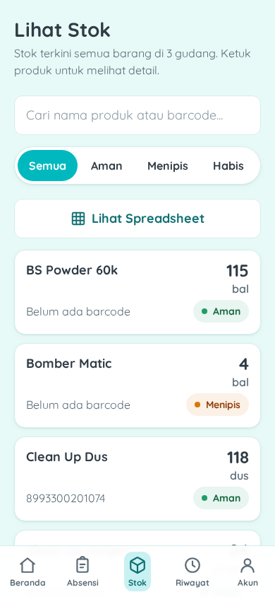

## 9. Laporan

Halaman **Laporan** (Admin, Bos, Manager) menampilkan rekap
kehadiran per periode: pilih rentang tanggal, lihat rekap per
karyawan (Hadir/Izin/Cuti/Total), lalu unduh CSV kalau perlu
dibuka di Excel. Rekap hanya menghitung absen yang sudah disetujui
Bos.

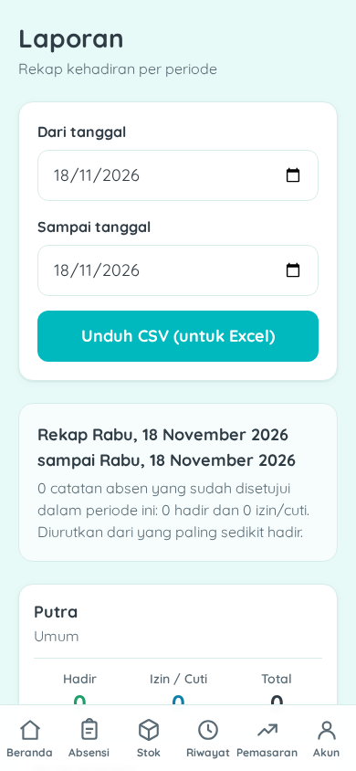

## 10. Pemasaran

Menu **Pemasaran** menampilkan ringkasan penjualan offline:
total penjualan, total kas masuk, selisih yang belum dibayar
pelanggan, grafik penjualan vs kas masuk per bulan, dan 10 produk
terlaris. Data dibaca langsung dari spreadsheet Analisis setiap
kali halaman dibuka; ketuk **Muat ulang** untuk membaca ulang.

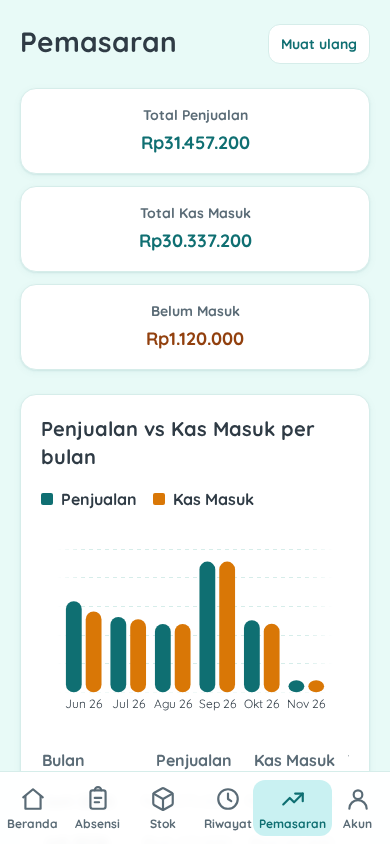

Yang bisa melihat menu ini: Admin, Bos, Manager, dan Staff yang
diberi akses lewat checkbox "Bisa lihat Pemasaran" (lihat bagian
7). Staff lain tidak melihat menu ini sama sekali.

Catatan: spreadsheet Analisis tidak punya data pengeluaran, jadi
grafiknya membandingkan penjualan dengan kas masuk, bukan pemasukan
dengan pengeluaran.

## 11. Kalau ada masalah

| Masalah | Yang dilakukan |
| --- | --- |
| Kamera tidak bisa dibuka di halaman scan | Pakai **Cari Manual** di bawah. Pastikan browser diizinkan memakai kamera (pengaturan HP, izin aplikasi browser). |
| "Anda di luar area pabrik" padahal sudah di pabrik | Nyalakan GPS/akurasi tinggi, tunggu beberapa detik, coba lagi. Kalau masih gagal, catat jarak yang tampil dan laporkan ke Admin (koordinat kantor mungkin perlu dikoreksi). |
| Data stok/absen tidak berubah setelah scan/absen | Tarik layar ke bawah untuk refresh, atau tutup lalu buka lagi aplikasinya. Periksa juga koneksi internet HP. |
| Tombol tidak merespons | Tutup aplikasinya dari daftar aplikasi terakhir, buka lagi. |
| Lupa kata sandi akun | Akun di halaman masuk bisa diketuk untuk mengisi otomatis. Kalau tetap tidak bisa masuk, hubungi Admin. |
| Menu Pemasaran tidak muncul | Menu itu hanya untuk manajemen dan karyawan tertentu. Kalau seharusnya bisa melihat, minta Admin mencentang "Bisa lihat Pemasaran" untuk akun Anda. |

Kalau masalah berlanjut, hubungi Admin (Zaky) dengan menyebutkan
halaman yang bermasalah dan pesan error yang tampil (kalau ada).
